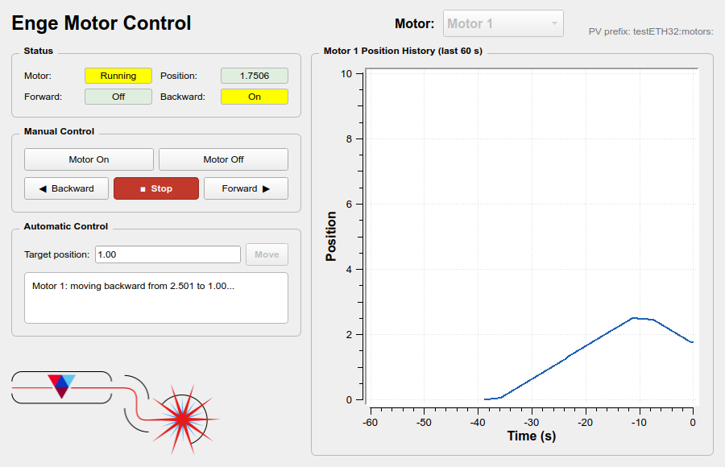

#+TITLE: ETH32 Motor Control
#+DATE: 2026-11-18

* What this is

This project controls up to *8 DC motors* through a Winfield *ETH32*
Ethernet I/O board, using EPICS. It has two parts:

1. *An EPICS IOC* (~asynPortDriverETH32/~). An asyn port driver turns
   each motor's direction pins on and off and reads each motor's
   position from an analog input. It can also run as a *simulation*
   with no hardware attached, which is how it is set up by default.
2. *A Python GUI* (~Frontend/motorcontrol/~). A PySide6 window, built
   with EPICS Qt (QE) widgets, for watching and driving one motor at a
   time, either by hand or by typing in a target position.

#+CAPTION: The motor control GUI during an automatic move of motor 1 (simulation)

The two parts talk only through EPICS Channel Access (CA) PVs, so any
other CA client (~caget~, ~caput~, ~camonitor~, CS-Studio, ...) can use
the IOC too.

#+begin_example
 +-----------+   Channel Access   +------------------+   Ethernet   +-------+
 |  GUI      | <----------------> |  IOC (asyn       | <----------> | ETH32 | --> motors
 |  (Python) |   PVs like         |  port driver)    |  (or the     +-------+
 +-----------+   M1For, M1Pos_RBV +------------------+   built-in simulation)
#+end_example

* Repository layout

| Path                                     | What it is                                              |
|------------------------------------------+---------------------------------------------------------|
| ~asynPortDriverETH32/src/~               | Driver source (~ETH32AsynPortDriver.cpp/.h~) and IOC main |
| ~asynPortDriverETH32/Db/~                | Database files: per-motor template and substitutions      |
| ~iocBoot/st.cmd~                         | IOC startup script                                      |
| ~configure/~                             | Standard EPICS build configuration (~RELEASE~ etc.)     |
| ~driver/~                                | Winfield's ETH32 C library source (see ~CompileNotes.org~) |
| ~Manuals/~                               | ETH32 manual and API reference (git-ignored)            |
| ~Frontend/motorcontrol/motorcontrol.py~  | The GUI program                                         |
| ~Frontend/motorcontrol/motorcontrol.ui~  | The GUI layout (edit with Qt Designer)                  |
| ~Frontend/motorcontrol/assets/~          | Images used by the GUI (the FENRIS logo)                |
| ~docs/~                                  | Images for this README                                  |
| ~bin/~, ~lib/~, ~db/~, ~dbd/~            | Build output, created by ~make~ (git-ignored)           |

* Requirements

- *EPICS base* and the *asyn* module. The paths are set in
  ~configure/RELEASE~: ~EPICS_BASE~ and ~ASYN~ (which is
  ~$(EPICS_SYNAPPS_BASE)/support/asyn-R4-36~).
- *The ETH32 library* (~libeth32~ and ~eth32.h~), only needed to talk
  to real hardware. Build it from ~driver/linux/~ with ~make~; see
  ~driver/CompileNotes.org~ for the fixes that modern GCC needs. The
  IOC Makefile links it from ~/usr/lib/~.
- *For the GUI:*
  - Python 3 with *PySide6* (Qt 6).
  - The *EPICS Qt framework* (~qeframework~), built against the /same/
    Qt 6 as PySide6, so the QE widgets (~QELabel~, ~QEPushButton~,
    ~QEPlot~) can be loaded.
  - The EPICS command-line tools ~caget~ and ~caput~ on your ~PATH~
    (used for automatic moves).

* Building the IOC

From the driver folder:

#+begin_src sh
cd asynPortDriverETH32
make
#+end_src

This builds the driver library and the ~ETH32AsynPortDriver~ IOC
executable, expands the motor database, and installs everything into
~bin/~, ~lib/~, ~db/~ and ~dbd/~ at the top of the project.

*Watch out:* ~configure/RELEASE~ finds asyn through the
~EPICS_SYNAPPS_BASE~ environment variable. If your environment points
at a different synApps tree (for example a newer asyn), the build will
fail with ~asynPortDriver.h: No such file or directory~. In that case,
set it for the build:

#+begin_src sh
EPICS_SYNAPPS_BASE=/path/to/synApps make
#+end_src

** Simulation or real hardware

Near the top of ~ETH32AsynPortDriver.cpp~:

#+begin_src c
// #define HAVE_ETH32
#+end_src

- *Commented out (default): simulation.* No ETH32 is needed. Each
  running motor's "position" moves at 0.1 V/s in its chosen direction,
  limited to 0-10 V. How often it updates is set by the ~UpdateTime~ PV
  (default 0.5 s).
- *Defined: real hardware.* The IOC connects to the ETH32 at the
  address in ~hostname[]~ (currently ~192.168.2.100~), sets ports 0 and
  1 as outputs, and reads all eight analog inputs on every update. At
  startup it blinks both LEDs for 10 seconds as a connection check.

Rebuild with ~make~ after changing this.

* Running the IOC

The startup script uses relative paths, so run it from ~iocBoot/~:

#+begin_src sh
cd iocBoot
../bin/linux-x86_64/ETH32AsynPortDriver st.cmd
#+end_src

This leaves you at an ~epics>~ prompt; the IOC runs until you exit it.
The PV prefix is set in ~st.cmd~ (~P=testETH32:,R=motors:~), giving PV
names like ~testETH32:motors:M1Pos_RBV~.

Quick test from another terminal:

#+begin_src sh
caput testETH32:motors:M1Run 1    # turn motor 1 on
caput testETH32:motors:M1For 1    # drive it forward
camonitor testETH32:motors:M1Pos_RBV
caput testETH32:motors:M1Run 0    # turn it off (also stops both directions)
#+end_src

/After rebuilding the driver, restart the IOC/: the running IOC keeps
using the old library until it is restarted.

* How the driver works

** Motors, addresses and pins

Each motor is one *asyn address* (motor /n/ is address /n/-1). The
ETH32 has 8 analog inputs, shared with the pins of digital port 3, so
8 motors (one position readback each) is the most a single ETH32 can
handle. Each motor uses two digital outputs, four motors per port:

| Motor | Port | Forward bit | Backward bit | Analog channel |
|-------+------+-------------+--------------+----------------|
|     1 |    0 |           0 |            1 |              0 |
|     2 |    0 |           2 |            3 |              1 |
|     3 |    0 |           4 |            5 |              2 |
|     4 |    0 |           6 |            7 |              3 |
|     5 |    1 |           0 |            1 |              4 |
|     6 |    1 |           2 |            3 |              5 |
|     7 |    1 |           4 |            5 |              6 |
|     8 |    1 |           6 |            7 |              7 |

Forward bits are always even and backward bits always odd. The driver
never lets both of a motor's pins be on: turning one direction on (or
off) also turns the other one off. Position is the analog voltage,
assuming the internal 5 V reference (0-1023 counts → 0-5 V).

~NUM_MOTORS~ and ~MOTORS_PER_PORT~ in ~ETH32AsynPortDriver.h~ set these
numbers. If you change ~NUM_MOTORS~, also change the motor list in
~Db/ETH32Motors.substitutions~ and ~NUM_MOTORS~ in ~motorcontrol.py~.

** PVs

For each motor /n/ = 1-8 (prefix ~testETH32:motors:~ by default):

| PV               | Type   | Meaning                                                         |
|------------------+--------+-----------------------------------------------------------------|
| ~M<n>Run~        | output | 1 = motor on ("Run"), 0 = off ("Stop"). Off also stops both directions. |
| ~M<n>Run_RBV~    | input  | Readback: "Running" (shown as a MINOR alarm) or "Stopped"       |
| ~M<n>For~        | output | 1 = drive forward                                               |
| ~M<n>For_RBV~    | input  | Readback of the forward pin                                     |
| ~M<n>Back~       | output | 1 = drive backward                                              |
| ~M<n>Back_RBV~   | input  | Readback of the backward pin                                    |
| ~M<n>Pos_RBV~    | input  | Position (analog input voltage)                                 |

Plus one pair shared by all motors:

| PV                  | Meaning                                 |
|---------------------+-----------------------------------------|
| ~UpdateTime~        | How often positions update, in seconds (minimum 0.1) |
| ~UpdateTime_RBV~    | Readback of the update time             |

The ~_RBV~ readbacks are the ones to watch. The driver can change a
value on its own (for example, setting Backward turns Forward off),
and only the readbacks show that.

** The database files

The records for one motor are in ~Db/ETH32Motor.template~ (macros ~N~ =
motor number, ~ADDR~ = asyn address). ~Db/ETH32Motors.substitutions~
lists motors 1-8; at build time EPICS's ~msi~ tool expands the two into
~db/ETH32Motors.db~. The update-time records are in
~Db/ETH32AsynPortDriver.db~. ~st.cmd~ loads both, passing ~P~, ~R~,
~PORT~ and ~TIMEOUT~.

** The update task

A background thread (~simTask~) handles positions:

- *Simulation:* when at least one motor is running, it wakes every
  ~UpdateTime~ seconds and moves each running motor by
  0.1 V/s × /the time that has actually passed/. (Using the real elapsed
  time means that waking early, for example when another motor is
  started, doesn't speed anything up.) When no motor is running, it
  sleeps until one is started.
- *Hardware:* it wakes every ~UpdateTime~ seconds and reads all eight
  analog inputs.

* Running the GUI

Start the IOC first, then:

#+begin_src sh
cd Frontend/motorcontrol
python3 motorcontrol.py
#+end_src

You can start it from any folder (for example
~python3 /path/to/Frontend/motorcontrol/motorcontrol.py~); it finds its
~.ui~ file and images next to itself.

** Environment

| Variable              | Needed for                                                              |
|-----------------------+-------------------------------------------------------------------------|
| ~QT_PLUGIN_PATH~      | Must include the qeframework's ~lib/<arch>~ folder, so Qt finds the QE designer plugin (~designer/libQEPlugin.so~) |
| ~LD_LIBRARY_PATH~     | Must let the system find ~libQEFramework.so~ and the EPICS libraries    |
| ~EPICS_CA_ADDR_LIST~  | Where to look for IOCs (e.g. ~127.0.0.1~ if the IOC is on this machine) |
| ~ETH32_PREFIX~        | /Optional./ PV prefix, default ~testETH32:motors:~. Change it if the IOC uses a different ~P~ and ~R~. |

If the QE widgets can't be found, the window fails to load, or the
readouts stay blank. Check ~QT_PLUGIN_PATH~ first.

** Using it

The window has a header and four sections:

- *Header:* the *Motor* selector (Motor 1-8) and the PV prefix in use.
  Everything else in the window follows the selected motor.
- *Status:* live readouts of the selected motor's Run state, Position,
  and Forward and Backward pins. They use EPICS alarm colours: green
  is normal and yellow is a MINOR alarm (used for "Running" and "On").
- *Manual Control:*
  - *Motor On / Motor Off* write ~M<n>Run~. The motor must be on before
    it will move. Turning it off also stops it.
  - *◀ Backward / Forward ▶* write ~M<n>Back~ / ~M<n>For~. The motor keeps
    moving until you stop it (or, in simulation, until it reaches 0 or 10).
  - *■ Stop* turns off both directions of the selected motor (the motor
    stays on) and cancels any automatic move.
- *Automatic Control:* type a *target position* from 0 to 10, in steps
  of 0.05, and press *Move* (or Enter). The motor is driven there and
  then turned off. Messages about the move appear in the box below.
  While a move is running, the Move button and the motor selector are
  locked.
- *Position History:* a plot of the selected motor's position over the
  last 60 seconds (fixed 0-10 scale). The history restarts when you
  switch motors.

** How an automatic move works

The move runs in a background thread (~MoveWorker~), so the window stays
responsive. It talks to the IOC with ~caget~ / ~caput~:

1. Read the current position. If it is already within 0.025 of the
   target, there's nothing to do.
2. Turn the motor on and set the direction (forward if the target is
   above the current position, backward if below).
3. Every 0.1 s, read the position. Stop when it reaches or passes the
   target. It never reverses to chase the target.
4. It also stops early if:
   - someone turns the direction or the motor off (the Stop button, a
     manual button, or another CA client) - detected from the ~_RBV~
     readbacks;
   - the position doesn't change for 5 s (the motor has stalled);
   - a ~caget~ / ~caput~ fails or times out (2 s);
   - the window is closed.
5. *Whatever happened, it finishes by turning off both directions and
   ~M<n>Run~.* If even that fails, the message says "Check the motor
   manually!".

The limits (0-10, 0.05 steps, 5 s stall time, 0.1 s polling, 2 s CA
timeout) are constants at the top of ~motorcontrol.py~.

* How the GUI is put together

- ~motorcontrol.ui~ is a Qt Designer file. ~motorcontrol.py~ loads it at
  run time with ~QUiLoader~, so you can change the layout in Designer
  without touching the Python. Open it with ~designer6 motorcontrol.ui~
  (with ~QT_PLUGIN_PATH~ set, so the QE widgets appear in Designer).
- Most of the window needs no Python at all. The *QE widgets* connect
  to their PVs themselves: a ~QELabel~ shows a PV, a ~QEPushButton~
  writes a value to a PV when clicked (~clickText~ sets the value; the
  default is 1), and a ~QEPlot~ plots a PV over time.
- *PV names use macros.* Each QE widget's ~variable~ is written like
  ~$(P)M$(M)For~, and its ~variableSubstitutions~ fills in ~P~ (the
  prefix) and ~M~ (the motor number). When you pick a motor, the Python
  code rewrites the substitutions on every QE widget, and they all
  reconnect to the new motor's PVs. This is also how ~ETH32_PREFIX~
  takes effect.
- The Python code adds only what QE widgets can't do on their own: the
  motor selector, the Stop button (which writes two PVs), and the
  automatic move logic.
- Widgets the Python code uses, by object name: ~motor_select~,
  ~desired_pos~, ~move_button~, ~stop_button~, ~status_message~,
  ~prefix_label~ and ~plot_group~. If you rename these in Designer,
  update ~motorcontrol.py~ too. The program checks for them at startup.
- The look (group boxes, the red Stop button, the readout borders)
  comes from a style sheet on the top-level widget in the ~.ui~ file.
- Images are referenced relative to the ~.ui~ file (e.g.
  ~assets/FENRISLogo-notext.png~).

* Troubleshooting

| Problem                                              | Likely cause / fix                                                     |
|------------------------------------------------------+------------------------------------------------------------------------|
| Build fails: ~asynPortDriver.h: No such file~        | ~EPICS_SYNAPPS_BASE~ points at the wrong synApps; see [[*Building the IOC][Building the IOC]] |
| GUI readouts blank / "Could not read ..." errors     | IOC not running, wrong ~EPICS_CA_ADDR_LIST~, or wrong ~ETH32_PREFIX~  |
| GUI fails to start: "missing a required widget"      | The ~.ui~ file doesn't match the names the Python code expects        |
| QE widgets missing or the window won't load          | ~QT_PLUGIN_PATH~ / ~LD_LIBRARY_PATH~ don't include the qeframework, or it was built for a different Qt |
| Motor doesn't move when Forward is pressed           | The motor is off: press *Motor On* first                              |
| Automatic move says "stalled"                        | The position stopped changing for 5 s (hardware problem, end of travel, or the motor was turned off elsewhere) |
| Changes to the driver have no effect                 | Rebuild with ~make~, then restart the IOC                             |
| Old PVs like ~testETH32:motors:Run~ not found        | Run is per motor now: use ~M1Run~ ... ~M8Run~                         |
